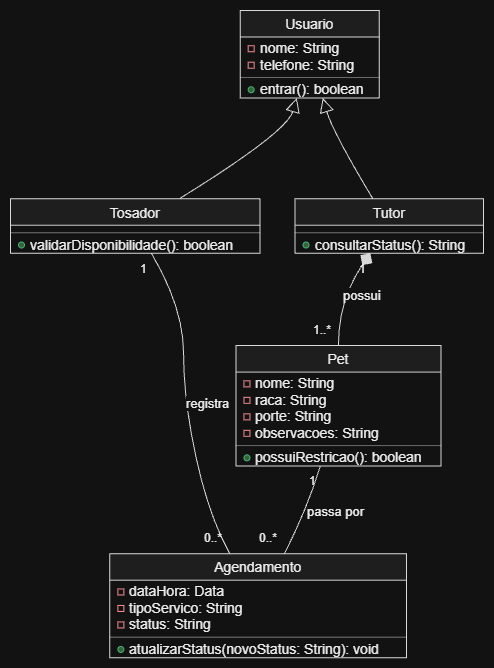
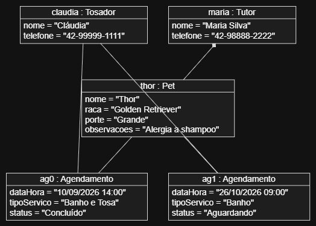

# 4.2.3 Modelagem de Classes

## Dos substantivos às classes

As classes saem dos substantivos identificados no fluxo principal e nas exceções do caso de uso `Registrar agendamento` (4.2.2), além da lista de requisitos da 4.2.1. Cada elemento informado ou verificado pelo sistema representa uma informação que precisa ser persistida.

Filtros aplicados: o que é detalhe virou atributo (como o porte e as alergias do pet), o que é elemento externo não entra (como a ficha de papel do balcão) e elementos de interface foram desconsiderados nesta etapa de análise.

| Substantivo | De onde veio | Vira | Por quê |
|---|---|---|---|
| tosador | ator da 4.2.2, RNF02 | classe **Tosador** | o sistema precisa autenticar quem agenda e quem atualiza o status dos serviços |
| tutor | ator da 4.2.2, HU01, RF01 | classe **Tutor** | o sistema guarda os dados de contato do cliente responsável pelo animal |
| nome, telefone | passos 1 e 3 do fluxo | atributos de **Usuario** | tosador e tutor possuem dados em comum; o que é comum sobe para a classe base |
| pet / animal | passos 1 e 2 do fluxo, RF01 | classe **Pet** | representa o animal que receberá o atendimento (banho/tosa) e suas restrições |
| raça, porte, observações | passo 2 do fluxo, RF01 | atributos de **Pet** | informações cruciais para o tosador planejar o atendimento sem riscos à saúde do animal |
| agendamento | passos 3 a 6 do fluxo, RF02, RF03 | classe **Agendamento** | registro central do sistema que vincula a data, o horário, o pet e o status do serviço |
| data, horário, status | passos 3 e 6 do fluxo, RF02, RF04 | atributos de **Agendamento** | detalhes do compromisso que organizam a fila do dia e evitam choque de horários |

## Classes

Cinco classes compõem o modelo do PetAgenda. Cada atributo possui tipo definido e cada operação apresenta sua origem rastreável na documentação.

| Classe | Atributos | Operações | Veio de |
|---|---|---|---|
| **Usuario** | - nome: String, - telefone: String | + entrar(): boolean | passos 1 e 3 (identificação), RNF02 (autenticação de acesso) |
| **Tosador** | _herda de Usuario_ | + validarDisponibilidade(): boolean | RNF02, RF07 e passo 4 do fluxo (validação de choque de agenda) |
| **Tutor** | _herda de Usuario_ | + consultarStatus(): String | RF05 (consulta pública do status do atendimento pelo cliente) |
| **Pet** | - nome: String, - raca: String, - porte: String, - observacoes: String | + possuiRestricao(): boolean | RF01, passo 2 do fluxo e exceção E2 (alerta de alergia ou grande porte) |
| **Agendamento** | - dataHora: Data, - tipoServico: String, - status: String | + atualizarStatus(novoStatus: String): void | RF02, RF03, RF04 e passo 6 do fluxo (registro e atualização da fila do dia) |

## Diagrama de classes

**Figura 2 – Diagrama de classes do PetAgenda**

Fonte: Autoria própria (2026).

A Figura 2 apresenta a estrutura estática do sistema PetAgenda composta por três tipos de relacionamentos:

- **Herança (triângulo vazado):** As classes `Tosador` e `Tutor` herdam de `Usuario`, reutilizando os atributos `nome`, `telefone` e a operação `entrar()`.
- **Composição (losango cheio):** Um `Tutor` possui uma relação de composição com `Pet` (`1` para `1..*`). O teste de dependência confirma: se o cadastro do tutor for excluído do sistema, os cadastros de seus pets vinculados deixam de existir.
- **Associação simples (linhas contínuas com multiplicidade):** Um `Tosador` registra zero ou vários (`0..*`) `Agendamento`. Um `Pet` passa por zero ou vários (`0..*`) `Agendamento`, mas cada `Agendamento` pertence a exatamente um (`1`) `Pet`.

## Teste de objetos

O teste de objetos valida as multiplicidades da modelagem de classes confrontando o diagrama contra uma situação real de atendimento do pet shop.

**Cenário:** A proprietária Cláudia (`claudia`: Tosador) registrou um agendamento (`ag1`) de banho para o cão Thor (`thor`: Pet) da tutora Maria (`maria`: Tutor). Thor já realizou outro serviço anterior (`ag0`) no mês passado.

**Figura 3 – Diagrama de objetos: um atendimento real no PetAgenda**

Fonte: Autoria própria (2026).

| Objeto | Classe | Valores |
|---|---|---|
| `claudia` | Tosador | nome = "Cláudia", telefone = "42-99999-1111" |
| `maria` | Tutor | nome = "Maria Silva", telefone = "42-98888-2222" |
| `thor` | Pet | nome = "Thor", raca = "Golden Retriever", porte = "Grande", observacoes = "Alergia a shampoo com perfume" |
| `ag0` | Agendamento | dataHora = "10/09/2026 14:00", tipoServico = "Banho e Tosa", status = "Concluído" |
| `ag1` | Agendamento | dataHora = "26/10/2026 09:00", tipoServico = "Banho", status = "Aguardando" |

**Ligações:** `maria` e `thor` (composição), `claudia` e `ag0`, `claudia` e `ag1`, `thor` e `ag0`, `thor` e `ag1`.

**O que o teste confirma:**
- **Um pet pode passar por múltiplos agendamentos ao longo do tempo:** O objeto `thor` está associado aos agendamentos `ag0` e `ag1`.
- **Um tutor pode ter um ou mais pets cadastrados:** `maria` está ligada a `thor` mantendo a regra `1..*`.
- **Cada agendamento individual possui exatamente um pet e um tosador responsável:** Os objetos `ag0` e `ag1` possuem exatamente uma conexão com `thor` e uma com `claudia`.

## Rastreabilidade com a 4.2.2

| Operação ou atributo | Classe | De onde veio |
|---|---|---|
| entrar() | Usuario | RNF02: autenticação de acesso ao sistema |
| validarDisponibilidade() | Tosador | RF07 e passo 4 do fluxo principal de Registrar agendamento |
| consultarStatus() | Tutor | RF05: consulta pública do atendimento pelo cliente |
| possuiRestricao() | Pet | RF01, passo 2 do fluxo principal e exceção E2 (alerta de saúde/porte) |
| atualizarStatus() | Agendamento | RF04 e passo 6 do fluxo principal |
| dataHora, tipoServico, status | Agendamento | RF02, RF03 e passos 3 e 6 do fluxo principal |

**Toda operação tem origem.** Todas as operações modeladas derivam diretamente dos passos executados pelo sistema ou dos requisitos funcionais estabelecidos nas seções 4.2.1 e 4.2.2.

**Todo passo do sistema tem casa.** Os passos 2, 4 e 6 do fluxo principal de agendamento encontram suporte direto em métodos das classes `Pet`, `Tosador` e `Agendamento`.

**O que a modelagem mudou.** A análise revelou que os dados de contato (`nome`, `telefone`) eram idênticos para clientes e tosadores, o que motivou a criação da classe base `Usuario` por herança para evitar duplicação de atributos no banco de dados.

