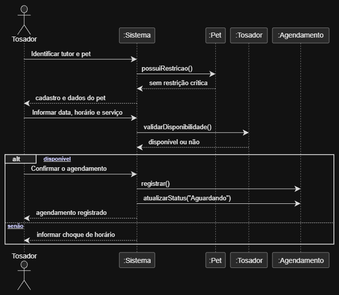

# 4.2.4 Modelagem de Sequência

## Do fluxo às mensagens

O diagrama de sequência detalha o cenário principal do caso de uso `Registrar agendamento` (da seção 4.2.2) como uma troca ordenada de mensagens entre o ator e as classes definidas na seção 4.2.3. Ele responde quem pede o quê, para quem, em que ordem e qual resposta retorna.

Aplicam-se três regras de tradução: cada passo do **Tosador** vira uma mensagem dele para `:Sistema` com o nome da ação da 4.2.5 (sem parênteses); cada passo do **Sistema** vira uma mensagem de `:Sistema` para a classe que possui a operação na 4.2.3 (com parênteses); e cada resposta volta em seta tracejada para quem solicitou.

A linha de vida `:Sistema` representa a camada de interface e controle que coordena as classes (equivalente à raia do Sistema na 4.2.5).

| No fluxo da 4.2.2 | Vira a mensagem | De quem para quem | Por quê |
|---|---|---|---|
| passo 1: o tosador identifica o tutor e o pet | **Identificar tutor e pet** | Tosador → :Sistema | passo do ator é mensagem dele para o Sistema, mantendo o nome da ação da 4.2.5 |
| passo 2: o sistema busca o cadastro e verifica restrições | **possuiRestricao()**, o retorno _sem restrição crítica_ e o retorno _cadastro e dados do pet_ | :Sistema → :Pet, e a resposta volta até o Tosador | quem guarda as restrições de saúde é o `Pet`. A consulta vai para ele e os dados retornam à tela |
| passo 3: o tosador informa data, horário e serviço | **Informar data, horário e serviço** | Tosador → :Sistema | passo de entrada de dados do ator |
| passo 4: o sistema verifica disponibilidade do tosador | **validarDisponibilidade()** e o retorno _disponível ou não_ | :Sistema → :Tosador | a operação mora em `Tosador`, que verifica sua grade de horários. A resposta decide o fragmento |
| passo 5: o tosador confirma o agendamento | **Confirmar o agendamento** | Tosador → :Sistema | passo de confirmação do ator |
| passo 6: o sistema registra o agendamento com status "Aguardando" | **registrar()** e **atualizarStatus("Aguardando")**, e o retorno _agendamento registrado_ | :Sistema → :Agendamento, e o retorno para o Tosador | um passo com duas ações internas vira duas mensagens: criar o registro e definir o status inicial |
| E1: horário indisponível/choque de agenda | fragmento **alt** com duas guardas: `[horário disponível]` cobre os passos 5 e 6, e `[senão]` traz o retorno _informar choque de horário_ | :Sistema → Tosador | o quadro `alt` mostra que apenas um dos dois caminhos acontece, refletindo a decisão _horário disponível?_ da 4.2.5 |
| A1 e E2: cadastro não encontrado e restrição crítica de saúde | ficam fora do desenho | nenhuma mensagem | já estão representados na Figura 4 (Atividades). O diagrama de sequência foca em um cenário para evitar poluição visual |

## Diagrama de sequência

**Figura 5 – Diagrama de sequência de Registrar agendamento**

Fonte: Autoria própria (2026).

A Figura 5 apresenta cinco linhas de vida. À esquerda está o ator **Tosador** (fora do sistema), seguido por **:Sistema** e pelos objetos das classes da 4.2.3 que participam ativamente deste cenário: `:Pet`, `:Tosador` e `:Agendamento`.

O tempo flui de cima para baixo. As **mensagens** (setas cheias) somam sete chamadas: três partem do ator para o `:Sistema` e quatro partem do `:Sistema` para as classes executarem suas operações. Os **retornos** (setas tracejadas) devolvem o resultado de cada consulta e a confirmação final para o ator. As chamadas `registrar()` e `atualizarStatus()` não possuem retorno próprio por serem operações de alteração de estado (`void`).

O quadro com a aba **alt** representa a alternativa da exceção **E1** (choque de horário), dividido em dois andares por uma linha tracejada: no andar superior (`[horário disponível]`), ocorrem a confirmação e o registro do agendamento; no andar inferior (`[senão]`), o sistema informa o choque de horário e encerra sem gravar.

As classes `Usuario` e `Tutor` não possuem linha de vida neste diagrama porque nenhuma mensagem deste cenário é enviada diretamente a elas (o método `consultarStatus()` de `Tutor` pertence a outro caso de uso). Linha de vida sem mensagem não entra no diagrama.

## Rastreabilidade com a 4.2.3

| Mensagem | Chega em | Operação na 4.2.3 | Passo da 4.2.2 |
|---|---|---|---|
| `possuiRestricao()` | `:Pet` | `Pet`, `+ possuiRestricao(): boolean` | passo 2 |
| `validarDisponibilidade()` | `:Tosador` | `Tosador`, `+ validarDisponibilidade(): boolean` | passo 4 |
| `registrar()` | `:Agendamento` |  não existe na 4.2.3 | passo 6 (primeira parte) |
| `atualizarStatus("Aguardando")` | `:Agendamento` | `Agendamento`, `+ atualizarStatus(novoStatus: String): void` | passo 6 (segunda parte) |
| Identificar tutor e pet, Informar data, horário e serviço, Confirmar o agendamento | `:Sistema` | nenhuma: são as três ações da raia do Tosador na 4.2.5 | passos 1, 3 e 5 |

**Toda mensagem com parênteses chega em quem tem a operação.** Três das quatro mensagens enviadas pelo `:Sistema` correspondem exatamente às operações já modeladas na seção 4.2.3. A quarta (`registrar()`) revelou uma lacuna na classe `Agendamento`.

**Todo passo tem mensagem.** Todos os 6 passos do fluxo principal estão representados na ordem cronológica exata, e a exceção E1 está contemplada no fragmento `alt`.

**O que o desenho mudou.** No passo 6 ("o sistema registra o agendamento com status Aguardando"), a seção 4.2.3 possuía apenas o método `atualizarStatus()`, mas não tinha uma operação explícita para persistir/criar o novo registro.
 **Para a próxima revisão da 4.2.3:** A classe `Agendamento` deve ganhar a operação `+ registrar(): void`.
