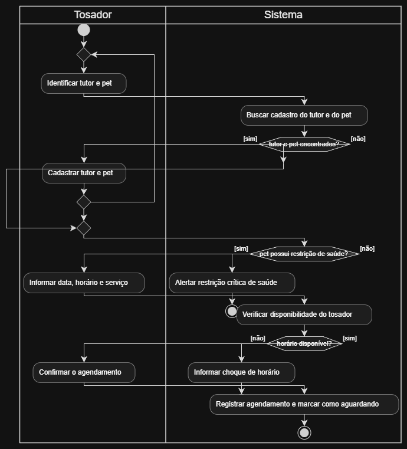

# 4.2.5 Modelagem de Atividade

## Do fluxo ao diagrama

O diagrama de atividades visualiza a execução do caso de uso principal `Registrar agendamento` da seção 4.2.2. A tradução segue rigorosamente o fluxo principal, o fluxo alternativo A1 e as exceções E1 e E2 do PetAgenda, sem adicionar elementos externos.

Aplicam-se três regras de tradução: cada passo vira uma ação na raia do responsável (Tosador ou Sistema); passos de verificação/confirmação viram ações seguidas de decisões com saídas guardadas (`[sim]` e `[não]`); e fluxos alternativos retornam por junção, enquanto exceções encerram em fins próprios sem a pós-condição.

| No fluxo da 4.2.2 | Vira | Raia | Por quê |
|---|---|---|---|
| passo 1: o tosador identifica o tutor e o pet | ação **Identificar tutor e pet** | Tosador | ação realizada pelo ator na interface do sistema |
| passo 2: o sistema busca o cadastro e verifica restrições | ação **Buscar cadastro do tutor e do pet**, e decisões _tutor e pet encontrados?_ e _pet possui restrição de saúde?_ | Sistema | o passo oculta duas conferências: a busca cadastral e a verificação de saúde do animal |
| A1: o sistema não encontra o tutor/pet, o tosador o cadastra e volta ao passo 1 | saída [não] da primeira decisão, ação **Cadastrar tutor e pet** e uma **junção** antes de Identificar tutor e pet | Tosador | o fluxo alternativo representa um desvio que retorna ao fluxo principal por uma junção |
| E2: o pet possui restrição crítica de saúde/alergia grave | saída [sim] da segunda decisão, ação **Alertar restrição crítica de saúde** e um **fim** próprio | Sistema | exceção que impede o agendamento normal sem autorização prévia; termina sem a pós-condição |
| passo 3: o tosador informa data, horário e serviço | ação **Informar data, horário e serviço** | Tosador | ação de entrada de dados realizada pelo ator |
| passo 4: o sistema verifica disponibilidade do tosador | ação **Verificar disponibilidade do tosador** e decisão _horário disponível?_ | Sistema | checagem de regras de negócio para evitar choque de agenda na grade |
| E1: horário indisponível/choque de agenda | saída [não] da terceira decisão, ação **Informar choque de horário** e um **fim** próprio | Sistema | exceção que encerra o fluxo sem efetuar o agendamento |
| passo 5: o tosador confirma o agendamento | ação **Confirmar o agendamento** | Tosador | ação final de validação executada pelo ator |
| passo 6: o sistema registra o agendamento com status "Aguardando" | ação **Registrar agendamento e marcar como aguardando**, e o **fim** do caminho feliz | Sistema | passo que concretiza o atendimento e entrega a pós-condição do sistema |

## Diagrama de atividades

**Figura 4 – Diagrama de atividades de Registrar agendamento**

Fonte: Autoria própria (2026).

A Figura 4 é dividida em duas raias verticais: a raia da esquerda pertence ao **Tosador** (ator) e a raia da direita pertence ao **Sistema**. As transições (setas) alternam entre as raias conforme a responsabilidade da ação.

O fluxo inicia no círculo cheio (**início**) no topo da raia do Tosador. Logo abaixo há uma **junção** (losango sem texto) onde o fluxo alternativo A1 (*Cadastrar tutor e pet*) se reconecta ao processo. Os três losangos com texto representam as **decisões** do sistema, cada uma com duas saídas rotuladas com as guardas `[sim]` e `[não]`.

O diagrama possui **três pontos de término (fins)**:
1. **Fim com pós-condição (alvo inferior):** Atingido apenas no caminho feliz após o registro bem-sucedido com status "Aguardando".
2. **Fim da exceção E1 (alvo à direita):** Ocorre quando há choque de horário na agenda do tosador.
3. **Fim da exceção E2 (alvo central à direita):** Ocorre quando o pet apresenta restrição grave de saúde registrada que impede o atendimento imediato.

## Rastreabilidade com a 4.2.2

| Elemento do diagrama | Vem de | Confere |
|---|---|---|
| Identificar tutor e pet, Informar data, horário e serviço, Confirmar o agendamento | passos 1, 3 e 5 (o tosador) | três ações executadas pelo ator na raia do Tosador |
| Buscar cadastro do tutor e do pet, Verificar disponibilidade do tosador, Registrar agendamento e marcar como aguardando | passos 2, 4 e 6 (o sistema) | três ações executadas pelo sistema alinhadas aos métodos `validarDisponibilidade()` e `atualizarStatus()` da 4.2.3 |
| tutor e pet encontrados? [não] | A1 (no passo 2) | desvio alternativo que retorna ao início via junção |
| pet possui restrição de saúde? [sim] | E2 (no passo 2) | exceção de saúde que encerra o caso sem a pós-condição |
| horário disponível? [não] | E1 (no passo 4) | exceção de agenda que encerra o caso sem a pós-condição |
| fim com a pós-condição | pós-condição da 4.2.2 | alcançado exclusivamente ao término do caminho principal |

**Todo passo tem elemento.** Todos os 6 passos do fluxo principal, o fluxo alternativo A1 e as exceções E1 e E2 possuem representação visual exata no diagrama.

**Toda decisão tem as duas saídas.** Cada losango de decisão apresenta caminhos `[sim]` e `[não]` devidamente direcionados para o caminho feliz, para o retorno de cadastro ou para a finalização por exceção.

**O que o desenho mudou.** A modelagem visual revelou que a checagem inicial do passo 2 envolvia duas validações distintas (existência de cadastro e restrições de saúde). A separação dessas duas decisões no diagrama evitou que a exceção de saúde E2 fosse confundida com o fluxo de ausência de cadastro A1.
