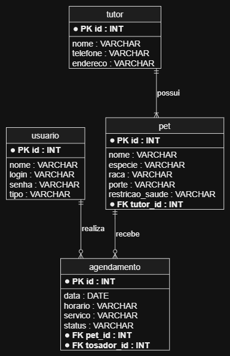

# 4.2.6 Modelagem de Banco de Dados

## Das classes às tabelas

O banco de dados persiste as informações que o PetAgenda precisa manter após o encerramento do sistema. O ponto de partida é o diagrama de classes da seção 4.2.3: cada classe vira uma tabela, cada atributo vira uma coluna em padrão `snake_case` (minúsculas, sem acento e com sublinhado) e cada associação vira uma chave estrangeira na tabela do lado do muitos.

As operações das classes (`possuiRestricao()`, `validarDisponibilidade()`, `registrar()`, `atualizarStatus()`, `consultarStatus()`) não entram no banco, pois representam comportamento executado pelo programa.

| Na 4.2.3 | Vira | Em qual tabela | Por quê |
|---|---|---|---|
| classe `Usuario` (`nome`, `login`, `senha`) e herança de `Tosador` | tabela `usuario`, com `id`, `nome`, `login`, `senha` e a coluna nova `tipo` | `usuario` | o banco relacional não possui herança; como `Tosador` compartilha a estrutura de acesso de `Usuario`, ambos são armazenados em `usuario` e diferenciados pela coluna `tipo` |
| classe `Tutor` (`nome`, `telefone`, `endereco`) | tabela `tutor`, com `id` e três colunas | `tutor` | classe vira tabela e atributos viram colunas; o `id` garante identificação única mesmo entre tutores homônimos |
| classe `Pet` (`nome`, `especie`, `raca`, `porte`, `restricaoSaude`) | tabela `pet`, com `id` e cinco colunas | `pet` | armazena os dados cadastrais e clínicos (alergias/restrições) de cada animal atendido |
| classe `Agendamento` (`data`, `horario`, `servico`, `status`) | tabela `agendamento`, com `id` e quatro colunas | `agendamento` | substitui o caderno físico da clínica, registrando cada horário marcado |
| associação: um `Tutor` possui `1..*` `Pet` | chave estrangeira `tutor_id` | `pet` | o lado do muitos está em `pet`; cada animal pertence a um único tutor, evitando múltiplos IDs na mesma célula |
| associação: um `Pet` recebe `0..*` `Agendamento` | chave estrangeira `pet_id` | `agendamento` | um pet passa por vários atendimentos ao longo do tempo, enquanto cada agendamento refere-se a um único pet |
| associação: um `Tosador` realiza `0..*` `Agendamento` | chave estrangeira `tosador_id` | `agendamento` | cada agendamento é executado por um tosador (referenciando `usuario.id`), e um tosador atende vários agendamentos |
| operações das classes (`validarDisponibilidade()`, `registrar()`, etc.) | nada | nenhuma | métodos pertencem à camada de aplicação (código), não à estrutura de armazenamento |

## Diagrama do banco de dados

**Figura 6 – Diagrama do banco de dados do PetAgenda**

Fonte: Autoria própria (2026).

A Figura 6 apresenta as quatro tabelas do PetAgenda: `usuario`, `tutor`, `pet` e `agendamento`. Cada caixa exibe o nome da tabela no topo e suas colunas com a indicação de chave primária (`PK`), chave estrangeira (`FK`) e tipo de dado (`INT`, `VARCHAR` ou `DATE`).

Existem três relacionamentos representados por linhas com notação pé de galinha:
1. **Tutor e Pet (`possui`):** Os dois tracinhos em `tutor` e o tracinho com pé de galinha em `pet` indicam que um tutor possui um ou vários pets (`1..*`), e cada pet pertence a exatamente um tutor (`1`). A chave `tutor_id` reside em `pet`.
2. **Pet e Agendamento (`recebe`):** Os dois tracinhos em `pet` e a bolinha com pé de galinha em `agendamento` indicam que um pet pode ter zero ou vários agendamentos (`0..*`), e cada agendamento pertence a um pet (`1`). A chave `pet_id` reside em `agendamento`.
3. **Usuario/Tosador e Agendamento (`realiza`):** Os dois tracinhos em `usuario` e a bolinha com pé de galinha em `agendamento` indicam que um tosador realiza zero ou vários agendamentos (`0..*`), e cada agendamento é vinculado a um tosador (`1`). A chave `tosador_id` reside em `agendamento`.

**Decisões de modelagem:** As cinco classes da seção 4.2.3 resultaram em quatro tabelas devido à unificação da herança `Usuario`/`Tosador` por meio da coluna discriminadora `tipo`. O sistema não possui relacionamentos muitos-para-muitos (`N:N`), dispensando tabelas associativas intermediárias.

## Rastreabilidade com a 4.2.3

| Na 4.2.3 | No banco | Confere |
|---|---|---|
| `Usuario` (`nome`, `login`, `senha`) e `Tosador` | `usuario` (`id`, `nome`, `login`, `senha`, `tipo`) | herança resolvida com coluna discriminadora `tipo` |
| `Tutor` (`nome`, `telefone`, `endereco`) | `tutor` (`id`, `nome`, `telefone`, `endereco`) | 3 atributos traduzidos para 3 colunas + `PK id` |
| `Pet` (`nome`, `especie`, `raca`, `porte`, `restricaoSaude`) | `pet` (`id`, `nome`, `especie`, `raca`, `porte`, `restricao_saude`, `tutor_id`) | 5 atributos traduzidos para 5 colunas + `PK id` + `FK` |
| `Agendamento` (`data`, `horario`, `servico`, `status`) | `agendamento` (`id`, `data`, `horario`, `servico`, `status`, `pet_id`, `tosador_id`) | 4 atributos traduzidos para 4 colunas + `PK id` + 2 `FK`s |
| `Tutor` 1 — 1..* `Pet` | `pet.tutor_id` | chave estrangeira no lado do muitos |
| `Pet` 1 — 0..* `Agendamento` | `agendamento.pet_id` | chave estrangeira no lado do muitos |
| `Tosador` 1 — 0..* `Agendamento` | `agendamento.tosador_id` | chave estrangeira no lado do muitos |

### Teste de linhas (instâncias reais do PetAgenda)

Abaixo, os objetos do cenário de teste da seção 4.2.3 (incluindo o cão Thor) são representados como registros nas tabelas, validando que cada associação corresponde a um valor único de chave estrangeira:

**Tabela `usuario`**

| id | nome | login | senha | tipo |
|---|---|---|---|---|
| 1 | Cláudia | claudia.admin | **** | tosador |
| 2 | Marcos | marcos.tosa | **** | tosador |

**Tabela `tutor`**

| id | nome | telefone | endereco |
|---|---|---|---|
| 1 | Carlos Silva | (42) 99911-2233 | Rua XV de Novembro, 410 |

**Tabela `pet`**

| id | nome | especie | raca | porte | restricao_saude | tutor_id |
|---|---|---|---|---|---|---|
| 1 | Thor | Cão | Golden Retriever | Grande | Nenhuma | 1 |
| 2 | Luna | Gato | Siamês | Pequeno | Alergia a shampoo comum | 1 |

**Tabela `agendamento`**

| id | data | horario | servico | status | pet_id | tosador_id |
|---|---|---|---|---|---|---|
| 10 | 2026-11-24 | 09:00 | Banho e Tosa | Concluído | 1 | 1 |
| 11 | 2026-11-30 | 14:30 | Banho Completo | Aguardando | 1 | 2 |

**Toda classe tem tabela, ou a decisão escrita.** As cinco classes da 4.2.3 estão contempladas: quatro viraram tabelas diretas e `Tosador` foi unificada em `usuario` conforme justificado na tabela de tradução.

**Todo atributo tem coluna.** Todos os 15 atributos das classes foram convertidos para colunas em `snake_case`, somando-se aos 4 identificadores (`id`), às 3 chaves estrangeiras (`_id`) e à coluna `tipo` (totalizando 23 colunas).

**Toda associação tem chave estrangeira.** As três associações da 4.2.3 viraram três colunas `_id` posicionadas no lado do muitos. No teste de linhas, as 5 ligações entre objetos (2 pets ligados ao tutor `1`, e 2 agendamentos do Thor ligados ao pet `1` e aos tosadores `1` e `2`) correspondem exatamente aos 5 valores preenchidos nas colunas `FK`.

**O que a tradução mudou.** A decisão sobre a herança criou a coluna `tipo` na tabela `usuario`. Além disso, a modelagem revelou uma regra que o diagrama de banco não consegue restringir sozinho:
❓ **Regra de integridade para a seção 3.3:** O banco garante que `tosador_id` aponta para um `usuario.id` válido, mas não impede que aponte para um usuário com `tipo` diferente de `"tosador"`. Essa validação ficará na camada de aplicação (seção 3.3).
